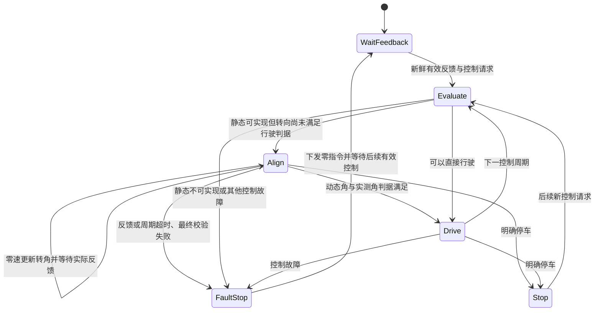

# 前轮转向、后桥驱动的控制方法与流程

本文依据当前 `front_steer_cmd` 实现整理，覆盖坐标与运动学、TEB 控制周期、底盘执行、反馈、保护及调试。适用于单前轮转向底盘，也适用于以等效前轮转角描述的双前轮阿克曼底盘。实车后桥驱动与当前 Gazebo 前轮驱动模型共享后轴中心接口，但驱动力分配不同。

相关文档：[接口与部署](front_steer_interface.md)、[Gazebo 功能仿真](gazebo_tricycle_simulation.md)。

## 1. 控制链与职责

```mermaid
flowchart TD
    A[导航目标与全局路径] --> B[Nav2 Controller Server]
    B --> C[TEB 局部轨迹优化与可行性检查]
    C --> D[速度饱和与前轮转向投影]
    D --> E[零速对准或正常行驶]
    E --> F[最终指令校验]
    F --> G[/front_steer_cmd：后轴中心速度与等效转角]
    G --> H[底盘执行层：驱动控制与转向闭环]
    H --> I[轮速编码器与转角传感器]
    I --> J[/front_steer_stu：实际速度、转角、转向转速]
    J --> C
    I --> K[里程计与定位]
    K --> C
    C --> L[返回实际输出的车体 Twist 供 Nav2 内部使用]
    L --> M{publish_twist 是否允许}
    M -->|允许| N[Controller Server 速度话题]
    F -->|失败| O[下发零指令并报告控制异常]
```

| 层级 | 负责内容 | 输出或边界 |
| --- | --- | --- |
| 全局规划与定位 | 给出路径、当前位姿 | 不直接控制电机 |
| TEB 优化 | 求解带时间的局部轨迹，考虑障碍物与运动约束 | 约束中包含优化惩罚，结果仍需检查 |
| TEB 直连接口 | 将 `v/omega` 转为受约束的 `v/delta`，处理反馈、对准和停车 | `/front_steer_cmd` |
| 底盘执行层 | 闭环控制驱动电机和转向机构，处理超时及执行器故障 | 实际执行结果及 `/front_steer_stu` |
| 里程计与定位 | 估计后轴参考点运动和位姿 | `/odom`、定位位姿和 TF |

当前 ROS 指令只含车体速度与等效转角。TEB 虽计算左右后轮速度供内部使用，但没有通过该指令消息单独发送两个后轮目标。

## 2. 坐标系、参考点与符号

采用车辆坐标系：x 向前、y 向左、z 向上。控制参考点为**后轴中心**。

| 符号 | 含义 | 单位与符号 |
| --- | --- | --- |
| `L` | 轴距 | m，当前 0.854 |
| `W` | 后轮轮距 | m，当前 0.84 |
| `v` | 后轴中心纵向速度 | m/s，前进正、倒车负 |
| `omega` | 车体偏航角速度 | rad/s，绕 +Z 为正 |
| `delta` | 等效前轮实际转角 | rad，朝左偏转为正 |
| `delta_dot` | 转向关节角速度 | rad/s，向正转角变化为正 |
| `r_L/r_R` | 左右后轮有效滚动半径 | m，需实际标定 |

正转角在前进时产生正偏航角速度，在倒车时产生负偏航角速度。倒车只改变 `v` 的符号，不能再次按速度符号翻转 `delta`。

如果 `base_link` 位于车体几何中心而非后轴中心，应明确另设后轴参考帧，并转换位姿与速度。只有旋转坐标轴而不处理速度参考点偏移是不够的：

```text
v_P = v_rear + omega_vector × r_rear_to_P
```

本接口及 odom 适配器不自动完成该参考点变换。当前仿真模型将 `base_footprint/base_link` 的平面原点设在后轴中心。

## 3. 车辆运动学与速度换算

### 3.1 车体模型

在理想平面、无侧滑条件下：

```text
x_dot     = v × cos(theta)
y_dot     = v × sin(theta)
theta_dot = omega = v × tan(delta) / L
curvature = tan(delta) / L
```

正常行驶时，由 TEB 的 `v/omega` 得到目标转角：

```text
delta_target = atan(L × omega / v)
```

这里使用 `atan` 保持倒车时的转角语义。不能在 `v` 接近 0 时直接除法；低速请求、静止对准和明确停车有各自处理分支。

### 3.2 后桥驱动

后轮滚动线速度：

```text
v_left  = v - omega × W / 2
v_right = v + omega × W / 2
```

如果左右后轮分别由独立电机驱动：

```text
wheel_rate_left  = v_left  / r_L     # rad/s
wheel_rate_right = v_right / r_R     # rad/s
wheel_rpm       = wheel_rate × 60 / (2*pi)
```

如果后桥由单个电机经机械差速器驱动，执行层根据 `v` 和传动比控制后桥输入，机械差速器允许左右轮产生不同转速；不应把两个独立轮速设定直接当成单电机的控制接口。无差速能力的刚性后轴在转弯时会出现滑移，不满足上述纯滚动假设。

轴距决定等效转角与曲率关系，后轮距决定左右后轮速度差。两者的作用不同。

### 3.3 单前轮与双前轮转向

单前轮底盘直接令实际转向关节跟踪 `delta_target`。

双前轮阿克曼底盘需要额外知道前轮距 `W_front`，由等效转角换算实际左右轮转角：

```text
kappa       = tan(delta) / L
delta_left  = atan2(L*kappa, 1 - W_front*kappa/2)
delta_right = atan2(L*kappa, 1 + W_front*kappa/2)
```

应根据真实机构检查内外轮转角及机械限位，不能默认前轮距等于后轮距，也不能将等效最大转角直接视为两个前轮各自的机械上限。

### 3.4 数值示例

`v=0.3 m/s、delta=0.4 rad、L=0.854 m、W=0.84 m` 时：

```text
omega   ≈ 0.14852 rad/s
v_left  ≈ 0.23762 m/s
v_right ≈ 0.36238 m/s
```

如果左右后轮半径都假设为 0.10 m，目标角速度分别约为 2.3762 和 3.6238 rad/s。该半径仅用于说明，不替代实车参数。

当前最大等效转角约为 60°，几何最小转弯半径约为：

```text
R_min = L / tan(delta_max) ≈ 0.4931 m
```

这只是几何结果。若车体角速度限制为 0.4 rad/s，在最大转角下允许的线速度约为 0.1972 m/s，不能同时要求最大转角与 0.5 m/s 的线速度。

## 4. ROS 指令与实际反馈

### 4.1 指令 `/front_steer_cmd`

类型：`capella_ros_msg/msg/FrontSteerDriveCmd`。

| 字段 | 语义 |
| --- | --- |
| `linear_x` | 期望后轴中心线速度，m/s |
| `front_steer_angle` | 期望等效前轮转角，rad |

不同控制动作：

| 动作 | 指令形式 | 执行含义 |
| --- | --- | --- |
| 正常前进 | `v > 0，delta` | 驱动后桥前进并闭环控制转向 |
| 倒车 | `v < 0，delta` | 后桥反转，保持转角符号定义 |
| 零速转向对准 | `v = 0，delta != 0` | 驱动目标为 0，转向机构继续跟踪目标 |
| 明确停车/故障停车 | `{v=0, delta=0}` | 按当前接口下发零指令，停止并清理历史 |

零速转向不是车体原地旋转。前者只改变前轮方向，车体 `omega` 仍为 0；后者要求车辆零纵向速度却有非零偏航角速度，当前运动模型不支持。

### 4.2 状态 `/front_steer_stu`

类型：`capella_ros_msg/msg/FrontSteerDriveStu`。

| 字段 | 当前约定与测量来源 |
| --- | --- |
| `linear_x` | 后轴中心实际线速度，m/s，可由后轮编码器或融合估计得到 |
| `front_steer_angle` | 传感器测得的等效实际转角，rad |
| `front_wheel_speed` | **转向关节绕 +Z 的实际转速，rpm** |

`front_wheel_speed = delta_dot_actual × 60/(2*pi)`。它不是前轮滚动轮速，也不是后轮轮速；转向速率上限 0.5 rad/s 对应约 4.7746 rpm。

反馈必须来自测量或仿真关节状态，不能回显目标指令。静止时仍持续发布，并保留实际转角；否则 TEB 无法判断零速对准是否完成。双前轮模型应由机构模型恢复一致的等效实际转角及其转速，不能不加说明地把其中一侧内轮角当成等效角。

TEB 当前只对 `front_wheel_speed` 检查有限值，不用它代替 `linear_x`，也没有根据该字段执行实测转向速率/加速度故障判定。转向动态限制主要施加在指令历史上，执行层仍需控制实际执行器。

## 5. 当前主要配置

以下放在 `controller_server.ros__parameters.FollowPath` 下，具体缩进以现有 YAML 为准：

```yaml
wheelbase: 0.854
rear_track: 0.84
front_steering_rear_drive: true
cmd_angle_instead_rotvel: false
no_inplace_rotation: true
max_vel_x: 0.5
max_vel_x_backwards: 0.5
max_vel_theta: 0.4
acc_lim_x: 0.3
acc_lim_theta: 0.6
max_steering_angle: 1.04719755
max_steering_rate: 0.5
max_steering_acceleration: 1.0
steering_min_speed: 0.03
front_steer_drive_interface:
  mode: front_steer_cmd
  publish_twist: false
  command_topic: /front_steer_cmd
  state_topic: /front_steer_stu
  state_timeout: 0.5
  max_projection_omega_error: 0.2
  odom_to_state:
    enabled: false
```

| 参数 | 控制含义 |
| --- | --- |
| `max_vel_x / max_vel_x_backwards` | 前进/倒车线速度幅值限制 |
| `max_vel_theta` | 车体偏航角速度限制，不是转向关节速度 |
| `max_steering_angle` | 等效转角幅值限制 |
| `max_steering_rate` | 指令转角一阶变化率限制，rad/s |
| `max_steering_acceleration` | 指令转角变化率的变化限制，rad/s² |
| `steering_min_speed` | 转向换算和低速判断门槛，不是静止对准转角死区 |
| `state_timeout` | 反馈与运动中控制间隔的时效保护，s |
| `max_projection_omega_error` | 静态可实现性及是否允许行驶的角速度误差门槛，rad/s |

`acc_lim_x` 同时参与 TEB 优化，并在 `front_steer_cmd` 最终发布端约束相邻线速度指令的正常变化量；直连模式要求其为有限正数。`acc_lim_theta` 仍主要参与车体角加速度优化，不能当成转向关节加速度限制。指令斜坡不等同于电机实际加速度已受硬保护，执行层仍需根据驱动能力、制动距离独立限制加减速。纵向斜坡、停车例外及低速起步见下文。

`front_steer_drive_interface.*` 在 configure 时固定，修改后重新 configure 或重启。`publish_twist` 的代码默认值为 true，当前参数文件显式关闭；该开关需要配套的工作区 `nav2_controller`。

## 6. 每个 TEB 控制周期的处理顺序

1. **初始化和反馈检查**：取得实际车体速度；直连模式要求状态有限、转角有效、反馈未超时。失败则中止本周期，异常保护下发零指令。
2. **位姿与路径处理**：使用定位/TF、全局路径和局部窗口，并处理路径等待、贴边、恢复等已有逻辑。
3. **局部轨迹优化**：计算带时间间隔的位姿序列，考虑障碍物、运动学与转向动态约束。
4. **可行性检查**：检查碰撞等条件；直连模式额外检查控制前视范围内的轨迹段，拒绝原地旋转和超转角的运动学结果。
5. **提取并饱和速度**：得到后轴中心 `v_request/omega_request`，限制线速度和角速度。`use_proportional_saturation` 决定按共同倍率还是分别饱和；后者可能改变曲率，因此仍需后续检查。
6. **检查静态可实现性**：暂不考虑上一周期的转向动态历史，投影到允许的转角、曲率和角速度范围。误差超过阈值时作为不可实现请求处理。
7. **应用转向动态限制**：从上一条实际已发布指令的角度及速率出发，生成本周期允许的目标角度。
8. **判断是否零速对准**：同时评估动态目标角和实际反馈角能否满足角速度误差门槛。未满足时将车体速度设为 0，保留受约束的转角目标。
9. **最终校验与发布**：检查状态时效和指令动态，根据上一条实际已发布的线速度应用纵向斜坡，并按最终转角重算车体角速度；执行速度/角速度边界保护，复核运动学一致性后发布并更新历史。
10. **返回 Nav2**：返回本周期实际输出的车体 Twist。对准时返回零车体速度，正常行驶时返回投影和纵向斜坡后的实际下发速度；是否向旧话题发布由 Controller Server 开关决定。

周期发生异常或提前返回时，有零指令保护路径。没有独立定时器重发上一条运动指令，所以底盘需要自己的指令超时保护。

## 7. 转向动态限制与零速对准

### 7.1 指令动态限制

核心离散关系如下，完整处理还包含曲率、角速度及转角边界投影：

```text
rate_candidate = (delta_candidate - delta_previous) / dt
|rate_candidate| <= max_steering_rate
|rate_candidate - rate_previous| <= max_steering_acceleration × dt
delta_command = delta_previous + rate_command × dt
```

直连模式还为转角边界和目标角预留制动空间。对剩余角度 `s`、转向加速度上限 `a`，允许的转向速率幅值按下式计算：

```text
braking_rate(s) = sqrt((a*dt)^2 + 2*a*s) - a*dt
rate*dt + rate^2/(2*a) <= s
```

它要求执行本周期角度变化后，仍有足够剩余角度把转向速率降为零。实际代码使用等价的有理化形式避免小角度消减误差，再与速率上限、上一速率允许的加速度区间求交。历史已经无法在机械角度边界内制动时仍报错停车，不强行生成违背动态约束的角度。

转角确定后，如果 `abs(v*tan(delta)/L)` 超过 `max_vel_theta`，直连模式保持转角和转向速率，降低线速度满足角速度限制：

```text
v_command = sign(v_request) * min(abs(v_request), max_vel_theta*L/abs(tan(delta)))
omega_command = v_command * tan(delta) / L
```

不能把角速度直接截断后再按原线速度反算转角，否则会破坏已经满足的转向加速度约束。转角为零时不需要上述除法。降低后的线速度进入低速门槛时按零速对准处理。

“previous”来自上一条实际已发布指令。被拒绝的候选指令不能作为新历史。明确停车属于优先动作，发送 `{0,0}` 并将指令转角与速率历史复位；实际转角是否已回零仍以反馈为准。

### 7.2 三种角速度比较

令 `E_max = max_projection_omega_error`：

```text
omega_static   = 不考虑转向动态历史时，静态投影得到的角速度
omega_dynamic  = 使用本周期受动态限制的转角计算出的角速度
omega_measured = v_request × tan(delta_measured) / L
```

`omega_measured` 是假设按请求速度行驶时，实测转角对应的预测偏航角速度，不是静止车辆当前测得的车体角速度。

| 条件 | 处理 |
| --- | --- |
| `abs(omega_request - omega_static) > E_max` | 静态不可实现，清理规划并停车报错 |
| 静态可实现，但动态角或实测角的预测误差大于 `E_max`，且请求速度高于低速门槛 | 零速对准，持续下发受约束的转角 |
| 静态、动态和实测角判据均满足 | 允许输出投影后的行驶速度 |
| 状态非法、过期或运动中控制间隔不可信 | 故障停车 |

### 7.3 概念状态流程

下图用于说明处理分支，不代表代码中另有同名状态枚举。



### 7.4 日志案例

曾出现的请求：

```text
v_request     = 0.309243 m/s
omega_request = -0.352808 rad/s
delta_target  ≈ -0.772386 rad
```

假设上一条指令的转角和速率均为 0，`dt=0.1 s`、转向加速度上限 1 rad/s²，则第一周期允许的速率量级为 -0.1 rad/s、转角量级为 -0.01 rad。直接按该角行驶时偏航角速度约为 -0.00362 rad/s，与请求差约 0.349 rad/s。

原处理把动态建立过程当作故障，每次停车又把历史清零，导致循环。当前处理保留受约束转角、保持车体零速，待实际转向满足误差门槛后行驶。不需要通过增大 0.2 rad/s 阈值来掩盖启动问题。

### 7.5 最终发布端的纵向加速度斜坡

普通运动指令按上一条实际发布的 `linear_x` 限制变化量：

```text
step = acc_lim_x × dt_linear
v_ramp = clamp(v_target, v_published_previous - step, v_published_previous + step)
```

已有发布历史时，`dt_linear` 取投影控制间隔与真实发布间隔的较小值，避免计算阶段延迟使下一条指令按过大的时间预算跳变；没有历史时使用正常控制周期。换向先斜坡减到零，再从零向反方向起步。

例如 `acc_lim_x=0.3 m/s²`、控制周期 0.1 s，正常起步目标即使为 0.5 m/s，也按约 `0.03、0.06、0.09…` 增长，达到 0.5 m/s 至少需要约 1.67 s。斜坡起步产生的 `0.03 m/s` 及更小的非零值不会因 `steering_min_speed` 而被清零；该门槛仍用于反馈低速处理和其他原有低速分支。

保持最终转角不变，使用 `omega = v_ramp*tan(delta_command)/L` 重新计算角速度。下发消息、调试话题、`last_cmd_`、后轮速度诊断及返回 Nav2 的 Twist 都使用最终实际输出。

斜坡不阻止安全动作：明确零指令、故障、反馈失效及零速对准可以直接输出零线速度；为了满足当前线速度上限或转角对应的角速度上限，也允许更快降速。因此正常加减速有斜坡约束，安全制动不保证遵循同一减速斜率。当前没有新增独立的减速度配置，执行层仍负责真实制动过程。

## 8. 反馈处理、低速与时间基准

原生状态换算为 TEB 车体速度：

```text
v_feedback = state.linear_x
omega_feedback = v_feedback × tan(state.front_steer_angle) / L
```

当前当 `abs(v_feedback) <= steering_min_speed` 时，将送入 TEB 的 `omega_feedback` 置 0，仍保留测得的线速度；实际转角仍保存在状态中，供对准判断使用。原生状态不会因接近静止而整条丢弃。

状态新鲜度按接收时刻的本地单调时钟判断，消息本身没有 header；它只能反映本节点最近收到数据，无法单凭该消息识别传输前已经陈旧的测量。底盘应持续发布新采样结果。

投影阶段确定一次 `dt`，本周期最终动态校验和速率历史更新使用同一值，避免发布前日志、可视化耗时改变加速度推导。最终发布另外检查真实距离上次发布的时间和状态时效。运动或转向中的长周期会停车；已下发明确零指令、转角/速率历史均为零且反馈新鲜静止时，可以按正常控制周期重新启动。

旧 `/odom` 近似状态转换只适合独立接口调试：运动时可由 `v/omega` 估算转角，静止时无法观测转向关节动作，所以不能承担当前零速对准闭环。它的可选 `wheel_radius` 分支仍按滚动转速填充诊断字段，与当前确认的“转向关节 rpm”约定不同。原生控制应设置 `odom_to_state.enabled: false`；如单独调试旧转换，应保持 `wheel_radius: 0`，该字段仅作未观测的零占位，不将其解释为真实转向转速。

## 9. 底盘执行层的控制流程

下述为后桥驱动实车的执行层要求，不代表 TEB 已实现电机控制器。

1. 接收并校验 `v/delta`，更新本地指令接收时间。根据底盘能力拒绝非法数值和超机械范围请求。
2. 根据指令时效、急停、驱动器故障等确定是否允许运动。超时停车不依赖 ROS 上层继续发送零值。
3. 根据转向传动比，将等效角转换为机构目标，并使用位置/角度反馈闭环；限制实际转向速度、加速度、电流或力矩。
4. `v=0, delta!=0` 时，维持驱动目标为 0，允许转向闭环继续建立角度。
5. 正常行驶时，机械差速桥跟踪桥输入目标；独立后轮电机则根据左右轮公式生成目标并执行轮速闭环。分别配置驱动和制动斜率。
6. 读取后轮编码器、实际转角和转向速度，统一符号、减速比和单位后发布实际状态。
7. 由轮速或融合状态产生后轴参考点里程计，同时保证 TF 与位姿使用同一参考关系。

命令中的零转角不等于物理执行器瞬间回零。执行层应按自身制动和转向约束执行，并如实反馈剩余速度与角度。

## 10. Gazebo 功能仿真与实车的区别

当前 `gazebo_ros_tricycle_drive` 保留**前轮转向与前轮驱动**，两个后轮自由滚动。它接收同样的后轴中心接口：

```text
front_rolling_rate_target = v_request / (front_radius × cos(delta_actual))
```

采用实际转角补偿转向过程中的速度参考点差异。后轴实际反馈由两个后轮编码器均值获得；转角和转向 rpm 由转向关节测量。

| 项目 | 后桥驱动实车/模型 | 当前 tricycle 功能仿真 |
| --- | --- | --- |
| 上层指令 | 后轴中心 `v/delta` | 相同 |
| 运动学关系 | 无侧滑近似下成立 | 相同近似下成立 |
| 驱动力 | 后桥或后轮电机 | 前轮 |
| 零速转向与反馈 | 需真实机构支持 | 插件已支持 |
| 可验证内容 | 机构、驱动与导航闭环 | 接口、转向建立、运动学及保护 |
| 不能互相替代的内容 | 后桥牵引力、滑移、载荷与制动特性 | 前轮驱动动力学不同 |

当前仿真轮胎半径为 0.10 m，是模型设定值。调整模型尺寸时同步调整 SDF、URDF、插件轮径、TEB 轴距/轮距和碰撞 footprint。

## 11. 故障与排查顺序

| 现象 | 优先检查 |
| --- | --- |
| 没有新鲜有效的状态 | 发布频率、消息类型、QoS、有限值、转角范围和本地超时 |
| `Front-steer aligning at zero speed` | 正常对准提示；观察目标转角是否逐步变化、实际转角是否跟随 |
| 一直对准不行驶 | 执行器是否支持静止转向；是否错误启用了 odom 状态转换；反馈是否回显目标或固定为 0 |
| `projection exceeds max_projection_omega_error` | 静态曲率、最大转角、角速度限制及低速旋转请求 |
| `steering rate/acceleration limit` | 查看上一转角/速率、控制间隔及是否加载了保留转角并降速的新直连投影；不要用角速度截断反算转角 |
| `Invalid front-steer input or control interval` | 非有限规划结果、周期过短/过长、计算耗时及线程阻塞 |
| 停车后又运动 | 底盘指令超时、旧桥接器、其他控制源及驱动器缓存 |
| 前进/倒车转向符号异常 | 后轮轴正方向、角度传感器符号、是否对倒车额外翻转转角 |
| Twist 仍在发布 | 配套 Controller Server 是否更新、当前控制器配置，以及其他节点的发布源 |

优先记录 `/front_steer_cmd`、`/front_steer_stu`、`/odom` 和 TF，并使用 `ros2 topic info -v` 确认控制话题发布者。调试标量话题便于比较目标与实际，但反馈调试话题会镜像非法输入，不能把其存在视为已通过有效性检查。

## 12. 实现入口与验证范围

| 位置 | 对应职责 |
| --- | --- |
| `front_steering_model.hpp` | 轨迹段运动学、曲率、转向动态投影与后轮速度换算 |
| `front_steer_drive_interface.hpp` | 配置/状态校验、静态可实现性与零速对准判据、最终指令校验 |
| `TebLocalPlannerROS::selectFrontSteerVelocity` | 原生状态优先与失效处理 |
| `TebLocalPlannerROS::applyFrontSteeringCommandLimits` | 控制间隔、历史、转向投影和对准 |
| `TebLocalPlannerROS::publishFrontSteerCommand` | 最终保护、实际发布及历史更新 |
| `ControllerServer::publishVelocity` | `publish_twist` 发布开关 |
| `gazebo_ros_tricycle_drive.cpp` | 功能仿真的执行器、超时、实际反馈与里程计 |

已有验证覆盖日志参数的持续控制回放、从零速对准进入行驶、反馈滞后、静态不可实现、延迟发布、空闲重启及超时；转向模型与接口两组测试覆盖的项目包括日志边界复现与速度/方向切换长序列。Gazebo 另有无界面运动回归，覆盖前进、倒车、左右转、停车、异常指令、超时和重置。

这些结果不代表真实车辆完成机械限位、转向电流、制动距离或全场景导航验收。实际落地应先校准参考点、符号与传动参数，再验证执行层闭环，最后在受控环境中验证导航路径跟踪。


## 13. 降低密集轨迹的计算量

TEB 优化节点原先在初始化时逐点复制局部全局路径。输入路径空间采样很密时，即使 `max_samples` 较小，初始图仍可能很大：该参数主要限制 autoResize 插点，不是强制裁剪原始输入点数。

当前新增两个参数，只在前轮转向模型首次初始化或重初始化优化轨迹时生效：

```yaml
global_plan_init_min_spacing: 0.10  # m；0 关闭降采样，代码默认 0
global_plan_init_max_angle: 0.10    # rad；保留转弯/姿态变化
```

按累计弧长采样，同时保留首尾、明显拐角、累计转弯、换向折点及原地姿态变化的两个端点。原始全局路径、途经点提取、剪枝及碰撞检查不删除；复杂路径为保留必要几何信息，初始化点数仍可能超过 `max_samples`。优化后还会按时间间隔自动增删点，所以该距离不是最终优化轨迹的固定空间分辨率。

当前部署配置进一步调整如下：

| 参数 | 调整前 | 当前 |
| --- | --- | --- |
| `dt_ref` | 0.2 s | 0.3 s |
| `dt_hysteresis` | 0.02 s | 0.05 s |
| `max_samples` | 100 | 60 |
| `min_samples` | 3 | 5，保留转向动态边所需节点 |
| `no_outer_iterations` | 4 | 3 |
| `no_inner_iterations` | 5 | 4 |
| `control_look_ahead_poses` | 4 | 3，维持约 0.9 s 控制前视 |

名义优化迭代预算从 20 次降至 12 次，实际耗时还受障碍物、初始化、数值收敛及线程调度影响，不能按比例保证实时性能。较粗时间采样和较少迭代会影响精度，应在相同路径和障碍物条件下检查跟踪误差及控制耗时；碰撞与最终指令保护保持开启。

`global_plan` 显示的仍可能是原始密集路径。判断实际优化节点数应查看 `teb_poses` 或 `local_plan`，初始化降采样数量可通过 DEBUG 日志 `TEB initialization seed: N -> M poses` 查看。低速时点间空间距离仍可能很小，这是时间离散的正常现象。

## 14. 到达终点后的原生停车

Controller Server 在确认到点、取消或异常后调用统一停车函数，现会直接向当前前轮转向控制器的原生指令话题发送 `{0,0}`，独立于旧 Twist 开关。修复前，该路径只有 Twist，而 `publish_twist: false` 会抑制这条消息，底盘可能只能等待指令超时再停。

原生停车发布器按控制器的 `command_topic` 配置创建，正常运动不使用它。TEB 的 `deactivate/cleanup` 也保留自身停车。最终验证应在原生 `/front_steer_cmd` 上确认收到零值，并结合实际反馈确认车辆停止；最后一条 TEB debug 镜像不包含 Controller Server 另外补发的停车消息。


## 15. 动态目标变化时的转向滞后降速

当前配置开启 `front_steer_drive_interface.steering_lag_speed_scaling`。第 7 节的零速对准仍是兼容模式与低速兜底；开启此选项后，优先在同一角速度误差预算内连续降低速度，允许转向机构边低速运动边建立角度，减少目标曲率频繁变化导致的反复全停。该选项不改变静态可实现性、碰撞、反馈和时序检查。

完整公式、兼容开关及停车来源的区分见 [动态避障一走一停排查](dynamic_avoidance_stop_go.md)。
