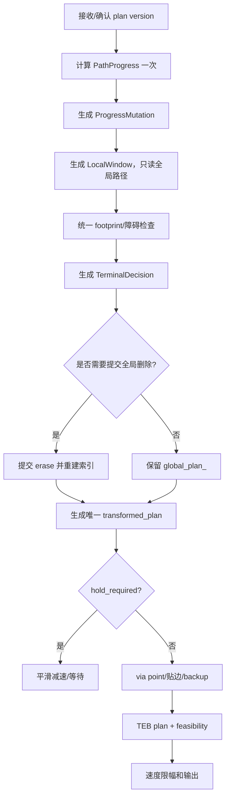

# 路径点管理四层重构方案

本文基于当前 `teb_local_planner` 的实际代码，分析路径点管理面对的场景、现有调用链和职责冲突，并给出按以下四层整合的重构方案：

```text
全局路径进度管理
  决定哪些路径点已经完成，避免跨行裁剪

当前行和局部窗口
  决定本周期截取哪些连续路径点，并过滤占用终点

障碍物和停车决策
  决定是否可以继续接近局部终点，必要时停车等待

TEB 输入和优化
  在局部终点安全且明确后，按照现有配置完成轨迹优化
```

## 1. 现有实现与运行时顺序

### 1.1 路径数据的生命周期

当前有三份语义不同但容易被混用的数据：

| 数据 | 当前含义 | 主要写入位置 | 主要消费者 |
|---|---|---|---|
| `origin_plan_` | `setPlan()` 清洗后的原始路径副本 | `setPlan()` | 调试和后续恢复，当前主流程很少读取 |
| `global_plan_` | 尚未被认为完成的剩余全局路径 | `setPlan()`、`pruneGlobalPlan()`、`pruneArrivedLockedCorner()`、`computeVelocityCommands()` 的行裁剪和角点分支 | 路径进度、局部窗、via point、可视化 |
| `transformed_plan` | 本周期变换到控制器坐标系的局部路径 | `transformGlobalPlan()` | 贴边、via point、停车判断、原地转向、TEB |

`setPlan()` 会删除无效四元数和相邻重复点，并清空多种终点/优弧状态；即使上层反复下发内容相同的路径，也会重置这些状态（见 `teb_local_planner_ros.cpp:613-697`）。这会影响终点等待锁、TEB warm start 和路径版本连续性。

### 1.2 当前一拍的真实顺序

`computeVelocityCommands()` 当前大致按以下顺序运行（见 `teb_local_planner_ros.cpp:777-1415`）：

```text
读取机器人位姿、速度和 goal checker 容差
  ↓
粗裁剪 pruneGlobalPlan(rough distance)
  ↓
精裁剪 pruneGlobalPlan(normal distance)
  ↓
pruneArrivedLockedCorner()
  ↓
再次独立寻找最近点和当前角点（贴边/角点碰撞使用）
  ↓
transformGlobalPlan()
  ├─ 再次寻找最近点
  ├─ 再次限制未完成角点
  ├─ 检查原始终点 footprint
  ├─ 计算当前行、前视范围和几何锁/占用锁
  ├─ 生成 transformed_plan
  └─ 返回可能删除 global_plan_ 的行区间
  ↓
调用方删除 transformGlobalPlan 返回的 global_plan_ 区间
  ↓
角点射线/footprint 检查，可能再次删除 global_plan_ 或截短 transformed_plan
  ↓
贴边改写 transformed_plan
  ↓
从 transformed_plan 生成 via point，配置 backup/倒车模式
  ↓
path wait、终点退让、终点占用停车判断
  ↓
原地转向（必要时跳过 TEB）
  ↓
填充 TEB 起点和终点，更新障碍物，执行 TEB 优化
```

这个顺序的问题是：同一周期中 `global_plan_` 可能已经变化，但 `transformed_plan`、`goal_idx`、角点位姿和停车状态仍来自变化前的快照。

### 1.3 当前路径进度和角点算法

角点工具位于 `detail/plan_corner_geometry.hpp`：

- `polylineVertexAngleDeg()` 用相邻路径点计算折线夹角，小于 `theta_threshold` 的顶点视为急弯。
- `findEuclideanClosestPlanIdx()` 在累计弧长上限内按欧氏距离找最近路径点，并在距离小于 0.5 m 后形成局部极小滞后。
- `clampClosestIdxBeforeUnprunedCorner()` 防止最近点越过尚未裁剪的第一个急弯。
- `lockedCornerIdx()` 从当前最近点开始锁定前视范围内的第一个急弯。
- `planArcLength()` 用路径弧长计算当前点到角点的距离。

这些规则专门解决弓字形、回字形和短换行段的跨行问题，但目前只有角点到达裁剪使用“沿路径弧长”的完成语义。普通 `pruneGlobalPlan()` 仍是独立的欧氏最近点搜索。

### 1.4 当前局部窗口算法

`transformGlobalPlan()` 位于 `teb_plan_window.cpp:481-1085`，当前做了四类工作：

1. 获取路径坐标系到控制器坐标系的 TF，并把机器人位姿变换到路径坐标系。
2. 计算最近点、前视弧长、当前角点和当前行终点。
3. 用带 `min_obstacle_dist` 横向膨胀的 footprint 检查路径点是否可通行。
4. 根据几何锁、占用锁和安全距离选择 `end_idx`，生成 `transformed_plan`，并返回可能删除的行区间。

实现上还存在一个需要在拆分时一并修复的边界问题：函数在检查 `global_plan.empty()` 之前就读取了 `global_plan[0]`（`teb_plan_window.cpp:498-509`）。路径被裁空或上层下发空路径时，这会先于正常错误返回触发越界访问。

占用锁的核心行为是：

- 局部窗口尾部附近存在占用点时，尝试使用 `candidate_is_safe()` 找到满足前后安全距离的离散路径点；
- 找到安全点时，把它设为局部终点；
- 找不到安全点时设置 `need_prune_remaining_row`，由调用方删除当前行的一段路径；
- 原始终点占用时设置 `occupied_goal_no_standoff_`，禁止本周期行裁剪，但仍先生成局部窗，随后由停车函数提前返回。

需要特别区分：当前代码的“找不到安全点”不会自动进入通用等待状态；它可能请求删行，也可能把回退后的局部窗交给 TEB，最终以 TEB 不可行结束。

### 1.5 当前障碍物和停车逻辑

停车判断发生在局部窗生成之后、TEB 优化之前（见 `teb_local_planner_ros.cpp:1187-1217`）：

| 函数 | 当前触发条件 | 结果 |
|---|---|---|
| `tryPathWaitHold()` | PATH 动态障碍走廊判定为 `WAIT` | 按加速度限制逐步减速，清空 TEB planner，保留全局路径 |
| `tryGoalStandoffHold()` | 旧的终点退让锁有效且接近退让点 | 直接输出零速度并保持 |
| `tryOccupiedGoalNearHold()` | 原始终点 footprint 占用，当前没有退让点 | 直接输出零速度停车；清除后延迟 0.4 s 释放；超时抛出异常 |

`selectGoalStandoffAlongPlan()` 已经不再搜索沿路径退让点：原始终点空闲则正常执行，原始终点占用则直接让 `tryOccupiedGoalNearHold()` 负责停车（`teb_plan_window.cpp:440-478`）。因此 `goal_standoff_*`、`transform_global_plan_goal_occupied_tolerance` 和 `transform_global_plan_goal_search_resolution` 中有一部分已经是兼容状态，应该在重构时重新命名或清理。

PATH 动态等待模块 `PathDynamicWaitGate` 会从 `global_plan_` 中全局寻找欧氏最近点，再沿路径采样 `path_wait_lookahead_dist`（`path_dynamic_wait.cpp:150-235`）。如果机器人靠近相邻清扫行，PATH 等待走廊可能和局部窗口使用的当前行不一致，这也是四层整合时必须统一路径进度输入的原因。

### 1.6 当前 TEB 输入和优化

停车判断通过后，代码把 `transformed_plan.back()` 作为局部目标，必要时用 `estimateLocalGoalOrientation()` 重写终点朝向，然后把首点替换为机器人当前位置（`teb_local_planner_ros.cpp:1290-1315`）。随后：

- 更新 costmap、converter 和自定义障碍物；
- 运行近场动态障碍门控；
- 以当前速度为起始速度调用 `planner_->plan()`；
- 做轨迹可行性检查；
- 在优弧、双弧倒车和窄道配置下按现有策略重试；
- 获取并限幅速度命令。

因此 TEB 本身适合做“给定安全局部路径后的轨迹优化”，不适合继续承担全局路径裁剪、行切换和终点占用判定。

## 2. 需要覆盖的场景与现有风险

### 2.1 直线长行正常前进

机器人沿当前长行前进，局部最近点、路径切线方向和行顺序一致。目标是稳定删除机器人后方的历史点，窗口沿当前行向前推进，TEB 获得连续的局部路径。

现有风险：粗裁剪和精裁剪分别重新搜索最近点；两个阈值不同，可能在同一周期删除不同范围。重构后应只生成一次路径进度结果，两个裁剪阶段只消费同一锚点。

### 2.2 避障后靠近相邻清扫行

弓字形或回字形路径的相邻行可能只相隔机器人宽度，甚至方向相同。机器人绕开障碍后，邻行的路径点可能比当前行更接近机器人。

目标行为：当前未完成换行角点之前，不能把邻行当作当前进度；避障结束后继续回到原始当前行。

现有保护：`clampClosestIdxBeforeUnprunedCorner()` 对 `transformGlobalPlan()` 和角点到达裁剪有效，但普通 `pruneGlobalPlan()` 自己搜索最近点，且其方向门控代码存在逻辑问题：第 278-285 行先把 `min_dist_threshold` 更新为当前距离并可能直接 `break`，第 287 行再次判断 `dist_sq < min_dist_threshold` 已不可能成立。因此注释中描述的方向继续搜索实际上不会生效。

### 2.3 接近第一个换行角点，不能提前锁第二个角点

短换行段中，第一个角点和第二个角点在平面距离上可能同时靠近机器人。目标是一次只锁定当前角点；机器人沿路径到达第一个角点后，下一周期才进入第二个角点。

现有 `lockedCornerIdx()` 通过“最近点是角点时从其前一个点开始搜索”和 `findFirstSharpCornerIdx()` 实现这一点。重构必须保留“角点是路径顺序状态”的语义，不能用任意平面半径一次裁掉两个角点。

### 2.4 角点被障碍物占用

目标是尽可能接近角点，在角点前最近的安全位置减速或等待，释放后继续；不能因为角点离散点占用就立即把整行当作已完成。

现有行为分成两条路径：

- `transformGlobalPlan()` 的占用锁可能回退到 `safe_idx`，或请求删除当前行区间；
- `computeVelocityCommands()` 后续角点射线检查还可能直接 `erase(global_plan_.begin(), begin + corner_index + 1)`，但此时 `transformed_plan` 已经按删除前的索引生成。

这会导致全局路径和局部路径版本不一致。重构后角点碰撞应只产生“角点不可达/临时终点/等待”的决策，由统一提交阶段修改全局路径。

### 2.5 180° 回头或反向换行

目标是机器人真正通过当前回头角点后及时删除旧段，并在下一周期使用新段。倒车段判断只应改变 TEB 的运动学偏好，不能代替全局路径进度。

现有 `pruneArrivedLockedCorner()` 的沿路到达条件是合理基础：先锁当前角点，再要求最近点到角点的路径弧长不超过 `last_corner_record_distance`，一次删除 `[0,C]`。重构中应把该结果放入统一 `PathProgress`，避免同一周期重新搜索角点。

### 2.6 当前行中间出现障碍物

目标是局部绕行仍然保留全局路径；如果安全距离不足，则以安全点为局部终点或停车等待，而不是立即删除后续任务路径。

现有 `candidate_is_safe()` 只在离散路径点上检查前后占用距离。路径采样稀疏时，两个离散点之间可能存在真正的碰撞区间；重构阶段应允许在路径段上插值生成候选安全终点，或者显式记录“离散检查不充分”的原因。

### 2.7 原始终点被占用

当前代码的事实是：原始终点 footprint 被判定为占用后，不再搜索 standoff 点，设置 `occupied_goal_no_standoff_`，保留全局路径并在 TEB 前直接输出零速度停车。清除后保持 0.4 s 再恢复，超过 `last_occupied_goal_hold_timeout` 则失败。动态 PATH 等待仍保留原有的按加速度限制减速逻辑。

重构目标不是恢复旧退让搜索，而是把该行为并入统一 `TerminalDecision`：终点占用属于“等待保持”，其触发、marker、距离和超时都从同一个终点决策派生。

### 2.8 动态障碍物挡住 PATH 走廊

`PathDynamicWaitGate` 维护每个障碍 ID 的等待和清除去抖状态，等待超时后进入 `DETOUR`。这个模块适合做障碍物语义判定，但它应使用同一个 `PathProgress.anchor_idx` 采样走廊，不能再次从整条 `global_plan_` 自由寻找最近点。

### 2.9 局部终点安全但 TEB 优化失败

这是 TEB 的正常失败场景：局部终点已经明确且 footprint 空闲，但运动学、障碍物或初值使优化不可行。此时才应执行优弧、双弧倒车、窄道和恢复策略。

终点占用、无安全局部窗、TF 失败和路径进度不确定应使用独立原因返回，不能统一伪装为 `trajectory is not feasible`。

## 3. 四层职责边界

### 3.1 第一层：全局路径进度管理

负责回答：**机器人沿任务路径已经完成到哪里，哪些历史点可以永久删除？**

只允许以下操作修改 `global_plan_`：

1. 删除已经沿路径通过的历史点；
2. 删除已经沿路径到达的当前角点及其之前点；
3. 上层显式下发新路径时重建路径版本；
4. 明确确认当前行放弃且后续路径仍存在时，删除被放弃行。

不能因为以下原因直接删除未完成路径：

- 相邻行的欧氏距离更近；
- 局部 TEB 轨迹暂时偏离原始路径；
- 一个离散角点 footprint 被占用；
- 一次 TEB 优化失败；
- 局部窗口长度不足。

建议对象：

```cpp
struct PathProgress {
  uint64_t plan_version = 0;
  int anchor_idx = 0;          // 当前路径进度锚点
  double anchor_arc = 0.0;     // 从当前剩余路径起点计的弧长
  int active_corner_idx = -1;  // 当前未完成角点
  int row_start_idx = 0;
  int row_end_idx = -1;
  bool corner_arrived = false;
  bool progress_valid = false;
};

struct ProgressMutation {
  int erase_from = -1;         // inclusive
  int erase_to = -1;           // inclusive
  const char * reason = nullptr;
};
```

`PathProgress` 每周期只计算一次；裁剪提交在决策完成后执行。提交后若索引发生变化，必须重新计算后续局部窗，不能继续使用旧索引。

### 3.2 第二层：当前行和局部窗口

负责回答：**从已确认的路径进度开始，本周期交给控制器的连续路径范围是什么？**

只读取 `global_plan_` 和 `PathProgress`，输出窗口描述，不直接删除全局路径：

```cpp
struct LocalWindow {
  int start_idx = -1;
  int candidate_end_idx = -1;
  int active_corner_idx = -1;
  int row_end_idx = -1;
  int first_occupied_idx = -1;
  int last_occupied_idx = -1;
  int last_free_idx = -1;
  int lock_mode = 0;       // 0 none, 1 geometric, 2 occupancy
  std::vector<geometry_msgs::msg::PoseStamped> plan_in_global_frame;
};
```

窗口边界优先级：

```text
未完成当前角点
  → costmap 可覆盖弧长
  → max_global_plan_lookahead_dist
  → 当前行尾或剩余路径终点
```

窗口阶段只做连续截取和占用采样。角点射线、贴边、via point 和 backup horizon 对窗口的修改都只能作用于局部副本。

### 3.3 第三层：障碍物和停车决策

负责回答：**局部窗口的最终终点是什么，机器人是否允许继续接近？**

建议用唯一的终点结果承载所有停车分支：

```cpp
enum class TerminalType {
  NormalLookahead,
  CornerApproach,
  SafeBeforeObstacle,
  GoalOccupiedHold,
  DynamicPathWait,
  NoSafeTerminal
};

struct TerminalDecision {
  TerminalType type = TerminalType::NoSafeTerminal;
  int plan_idx = -1;
  geometry_msgs::msg::PoseStamped pose;
  double remaining_arc = 0.0;
  double braking_distance = 0.0;
  bool hold_required = false;
  bool goal_occupied = false;
  bool corner_occupied = false;
  std::string reason;
};
```

推荐优先级：

```text
TF/路径无效           → ERROR，不进入 TEB
动态 PATH 等待         → DynamicPathWait
原始终点 footprint 占用 → GoalOccupiedHold
当前角点占用           → SafeBeforeObstacle 或 DynamicPathWait
窗口尾部占用           → SafeBeforeObstacle
安全角点               → CornerApproach
普通窗口               → NormalLookahead
```

判断停车时使用沿路径剩余弧长，并与制动距离和安全裕度比较：

```text
remaining_arc <= braking_distance
              + occupied_goal_braking_margin
              + footprint_safety_margin
```

一旦 `hold_required=true`，本周期不调用 TEB。保持函数只负责从当前速度平滑减到零，并消费 `TerminalDecision`，不再分别读取多个互相独立的终点状态。

### 3.4 第四层：TEB 输入和优化

负责回答：**在局部终点已经安全、连续、明确的前提下，如何求当前速度？**

TEB 层接收：

- 机器人当前位置和当前速度；
- 已确定终点的 `transformed_plan`；
- 障碍物容器和动态障碍门控结果；
- via point；
- 现有运动学、速度、加速度、优弧和倒车配置。

TEB 层不修改 `global_plan_`，不决定当前角点是否完成，也不把占用点转换成安全点。优化失败时返回明确分类：`NoSafeTerminal`、`TerminalHold`、`TebInfeasible`、`TebCommandInvalid`。

## 4. 推荐的单周期流程



### 步骤 A：路径版本和输入快照

`setPlan()` 清洗路径后计算稳定的 `plan_version`。建议使用路径内容摘要（点数、首尾点、抽样点和 frame）判断上层是否真的换了路径：

- 路径版本未变：保留等待状态、当前角点和 TEB warm start；
- 路径版本改变：清除与旧路径索引绑定的进度和终点状态。

### 步骤 B：一次性计算路径进度

使用投影到路径段的结果作为锚点，而不是只使用路径顶点欧氏距离。投影结果至少包含：

```text
segment_idx
segment_fraction
arc_from_plan_start
lateral_distance
tangent_yaw
```

搜索范围从上一周期的 `anchor_idx` 附近开始，并受未完成角点限制。允许机器人绕障短暂偏离路径，但不允许一次跨过完整换行段。

### 步骤 C：生成并提交历史点删除

粗裁剪和精裁剪应变成同一 `ProgressMutation` 的不同阈值计算，而不是各自搜索最近点。提交前检查：

- 删除区间不包含 `active_corner_idx` 之前尚未完成的路径；
- 不删除全局最后一个点；
- 不跨过当前行到邻行；
- `erase_to` 只来自沿路径已通过或已到达角点的证据。

角点到达使用 `planArcLength(anchor_idx, active_corner_idx) <= last_corner_record_distance`。一次只提交当前角点，不连带删除下一个角点。

### 步骤 D：生成局部窗口

窗口模块按已确认的 `anchor_idx`、`active_corner_idx` 和行边界截取连续点。占用检查产生完整的 `OccupancyProfile`：

```cpp
struct OccupancyProfile {
  std::vector<double> arc_from_anchor;
  std::vector<uint8_t> footprint_occupied;
  int first_occupied = -1;
  int last_occupied = -1;
  int last_free = -1;
};
```

安全终点可以是离散点，也可以是占用点之前的路径段插值点。若只能返回离散点，必须记录采样分辨率和保守安全余量。

### 步骤 E：生成唯一终点决策

所有终点相关信息从同一份 `TerminalDecision` 派生：

- `goal_idx`；
- `path_key_points.terminal`；
- 终点占用 marker；
- `occupied_goal_dist_m_`；
- 停车保持状态；
- TEB 的 `transformed_plan.back()`。

这样可以消除“局部窗已经选安全点，但停车判断仍引用原始终点”的不一致。

### 步骤 F：提交全局路径变更并生成局部副本

如果终点决策要求放弃当前行，先提交 `global_plan_` 删除，再用新的索引重新生成窗口。若不需要删除，则保留全局路径。之后所有贴边、角点截短、via point 和 backup horizon 只操作 `transformed_plan`。

### 步骤 G：停车或进入 TEB

停车优先级固定为：动态 PATH 等待、终点占用等待、角点前安全等待、普通局部规划。只有 `hold_required=false` 且局部终点 footprint 安全时，才执行原地转向和 TEB。

## 5. 现有函数的重构映射

| 现有函数/逻辑 | 当前混合职责 | 重构后归属 |
|---|---|---|
| `setPlan()` | 清洗路径、重置所有状态 | 路径版本和输入快照 |
| `pruneGlobalPlan()` | 重新搜索最近点并删除历史点 | `PathProgress` 计算/提交 |
| `pruneArrivedLockedCorner()` | 重新搜索角点并删除角点 | `PathProgress` 的角点到达提交 |
| `findEuclideanClosestPlanIdx()` | 作为多个模块的独立最近点搜索 | 改成统一进度投影的候选实现 |
| `clampClosestIdxBeforeUnprunedCorner()` | 防止跨未完成角点 | 保留为进度硬约束 |
| `lockedCornerIdx()` | 独立确定几何锁角点 | 读取 `PathProgress.active_corner_idx` |
| `transformGlobalPlan()` | TF、最近点、终点选择、占用、请求删行 | 拆成 `buildLocalWindow()` 和 `evaluateTerminal()` |
| 角点射线/footprint 分支 | 检查障碍并直接修改全局/局部路径 | 只输出角点障碍证据 |
| `selectGoalStandoffAlongPlan()` | 旧终点退让状态 | 并入 `TerminalDecision`；废弃未使用的网格搜索参数 |
| `tryPathWaitHold()` | 动态 PATH 停车 | 消费 `TerminalDecision`，保留 Gate 状态机 |
| `tryGoalStandoffHold()` | 独立终点退让停车 | 合并到统一保持处理器 |
| `tryOccupiedGoalNearHold()` | 依据全局变量停车 | 依据 `TerminalDecision` 停车 |
| `updateViaPointsContainer()` | 从局部窗生成 via point | 保留在 TEB 输入层 |
| `configureBackupModes()` | 缩短局部窗 | 只允许在终点决策之后缩短副本 |
| `planner_->plan()` | TEB 优化 | 保留，只接收最终安全窗口 |

## 6. 分阶段实施建议

### 阶段 0：建立行为基线

先不改算法，补充结构化日志和调试输出：

```text
plan_version
anchor_idx / anchor_arc
active_corner_idx / row_end_idx
window_start / window_end
first_occupied / last_free
terminal_type / terminal_idx / hold_reason
global_plan erase range
```

同时为每周期记录唯一的路径索引快照，定位当前多次搜索造成的差异。

### 阶段 1：修正最近点和裁剪一致性

1. 修正 `pruneGlobalPlan()` 中方向门控的不可达分支；
2. 引入统一 `PathProgress`，让粗裁剪、精裁剪、角点搜索和 `transformGlobalPlan()` 共享锚点；
3. 所有裁剪都禁止越过 `active_corner_idx`；
4. 先保守关闭粗裁剪的跨段能力，确认不会误删相邻行后再恢复性能优化。

同时应把空路径检查前移到 `transformGlobalPlan()` 的第一行，并让调用方把空路径分类为“路径完成/等待上层新路径”，不要将其当作普通 TEB 优化失败。

### 阶段 2：拆分窗口生成和全局删除

1. 将 `transformGlobalPlan()` 拆成 TF/窗口计算和终点评估两个纯结果函数；
2. 删除请求变成 `ProgressMutation`，由主流程统一提交；
3. 提交删除后重新计算索引和窗口；
4. 角点射线分支禁止直接 `erase(global_plan_)`。

### 阶段 3：统一终点和停车状态

1. 引入 `TerminalDecision`；
2. 将原始终点占用、当前行安全点、角点前点和 PATH 等待映射到统一终点类型；
3. marker、`goal_idx`、停车距离和保持状态全部从统一结果派生；
4. 删除或标记废弃不再使用的 standoff 搜索参数。

### 阶段 4：让动态等待和贴边消费统一进度

1. `samplePathWaitCenterline()` 接收 `anchor_idx` 和当前行边界；
2. 贴边输入只使用最终 `transformed_plan`，不再自行推断全局进度；
3. 动态障碍门控仍可独立维护障碍 ID 状态，但路径几何必须来自同一窗口。

### 阶段 5：收敛 TEB 输入和错误分类

1. TEB 前增加终点安全断言；
2. 区分 `NoSafeTerminal`、`TerminalHold`、`TebInfeasible`、`TebCommandInvalid`；
3. 只对 `TebInfeasible` 执行现有优弧、双弧倒车和恢复逻辑；
4. 保留现有 TEB 参数和优化策略，避免重构路径管理时同时改变控制器调参。

## 7. 参数整理建议

| 参数 | 当前状态 | 建议 |
|---|---|---|
| `rough_global_plan_prune_distance` | 粗裁剪独立搜索 | 改为进度模块的保守历史点清理阈值 |
| `global_plan_prune_distance` | 精裁剪独立搜索 | 改为同一锚点的确认阈值 |
| `transform_global_plan_closest_search_max_accum_dist` | 窗口内部最近点搜索上限 | 统一为进度投影搜索上限 |
| `theta_threshold` | 角点判定 | 保留，作为行/角点边界唯一来源 |
| `last_corner_record_distance` | 角点沿路到达阈值 | 保留，作为全局进度推进条件 |
| `transformed_plan_collision_pose_to_end_distance` | 尾部占用触发距离 | 改名为局部窗口占用检测前视距离，避免和全局进度混淆 |
| `transformed_plan_collision_pose_safe_distance_front/back` | 安全终点前后间距 | 保留在 `OccupancyProfile`/终点评估层 |
| `transformed_plan_row_terminal_arrive_distance` | 到达安全行尾后请求删行 | 改为显式的行完成提交阈值 |
| `goal_standoff_stop_distance` | 当前实现只作兼容配置 | 统一到 `TerminalDecision` 后废弃或重新定义 |
| `transform_global_plan_goal_occupied_tolerance` | 当前未用于真正搜索 | 若不恢复搜索应删除；若保留则实现可测试的路径段退让 |
| `transform_global_plan_goal_search_resolution` | 当前未用于真正搜索 | 同上 |
| `last_occupied_goal_dist` | 当前不再决定终点停车触发 | 改为兼容别名或删除，停车改用弧长+制动距离 |
| `last_occupied_goal_hold_timeout` | 终点占用保持超时 | 保留，归入停车状态机 |
| `path_wait_*` | 动态障碍 PATH 等待 | 保留，但走廊采样必须使用统一锚点 |

## 8. 测试与验收场景

### 单元测试

建议为纯函数补充以下测试：

1. 路径投影在相邻平行行之间选择当前顺序段；
2. 未完成角点存在时，最近点不能越过角点；
3. 粗裁剪和精裁剪对同一 `PathProgress` 产生单调的删除区间；
4. 当前角点到达只删除一个角点，不连带删除短边后的下一个角点；
5. 180° 回头段在沿路到达后切换到下一段；
6. 离散占用点前的安全终点满足前后安全距离；
7. 原始终点占用产生 `GoalOccupiedHold`，且不产生全局路径删除；
8. 动态 PATH 走廊从锚点开始采样，不从相邻行重新找最近点；
9. `TerminalDecision::hold_required` 时不会调用 TEB。

### 集成场景

| 场景 | 关键断言 |
|---|---|
| 长行直行 | 历史点单调减少，窗口连续，TEB 正常输出 |
| 绕障靠近相邻行 | 当前角点未完成，不跨行裁剪，障碍清除后回原始行 |
| 短换行段 | 当前窗口只锁第一个角点，不能一次跳到第二个角点 |
| 角点被占用 | 停在角点前安全位置或等待，不直接删除整行 |
| 180° 回头 | 通过当前角点后下一周期进入新行 |
| 当前行中间障碍 | 局部终点后移到安全点，全局后续路径保留 |
| 原始终点占用 | 直接零速、释放去抖、超时失败 |
| 动态障碍挡 PATH | WAIT 阶段不调用 TEB，超时后的 DETOUR 行为可观测 |
| TEB 优化失败 | 日志区分终点安全问题和优化不可行 |
| TF 暂时失败 | 不删除路径；输出安全零速或由上层处理 |
| 重复下发相同路径 | 路径版本不变时不清除进度和等待锁 |

### 运行时不变量

每个控制周期都应满足：

```text
1. global_plan_ 非空时，anchor_idx 在有效范围内。
2. active_corner_idx >= 0 时，anchor_idx <= active_corner_idx。
3. global_plan_ 的删除区间不跨过未完成 active_corner_idx。
4. transformed_plan 的点按 global_plan_ 顺序连续。
5. hold_required=true 时不调用 planner_->plan()。
6. TEB 的终点 footprint 不占用且与 TerminalDecision 一致。
7. global_plan_ 删除后不继续使用删除前的 goal_idx/path_key_points。
```

## 9. 结论

现有实现已经具备许多可复用的基础：沿路径角点到达裁剪、当前行几何锁、footprint 安全点筛选、PATH 动态等待、终点占用减速和 TEB 多策略重试。主要问题是这些能力在同一控制周期内分别重新推断路径进度，并在不同阶段交叉修改 `global_plan_` 和 `transformed_plan`。

重构的核心不是重新发明 TEB，而是建立一条单向数据流：

```text
PathProgress
  → LocalWindow
  → OccupancyProfile
  → TerminalDecision
  → transformed_plan
  → TEB
```

全局路径只由进度层提交删除，局部窗口只负责连续截取，障碍物层只决定终点和停车，TEB 只优化已经确认安全的局部输入。这样可以保留现有参数和控制策略，同时消除跨行裁剪、终点状态不一致、角点删除后继续使用旧窗口以及“无安全终点被误报为 TEB 失败”等问题。
